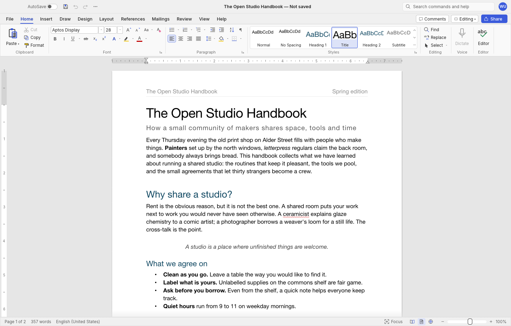
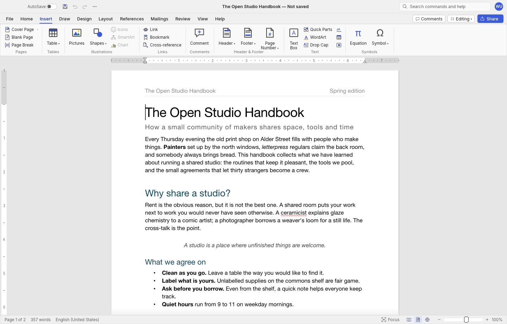
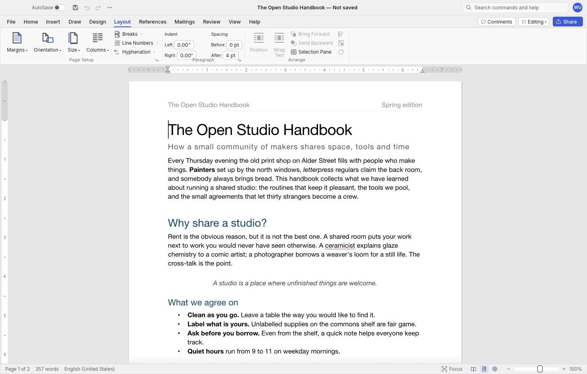
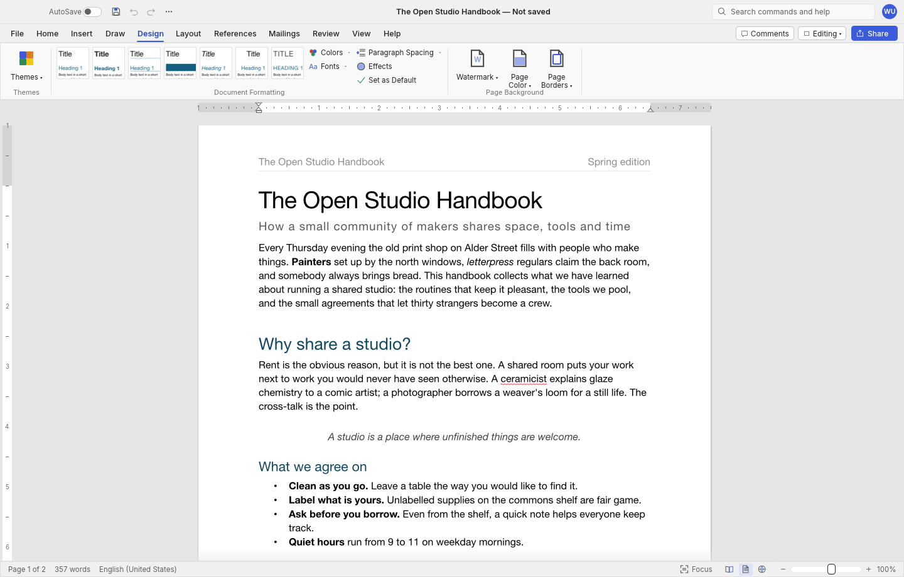
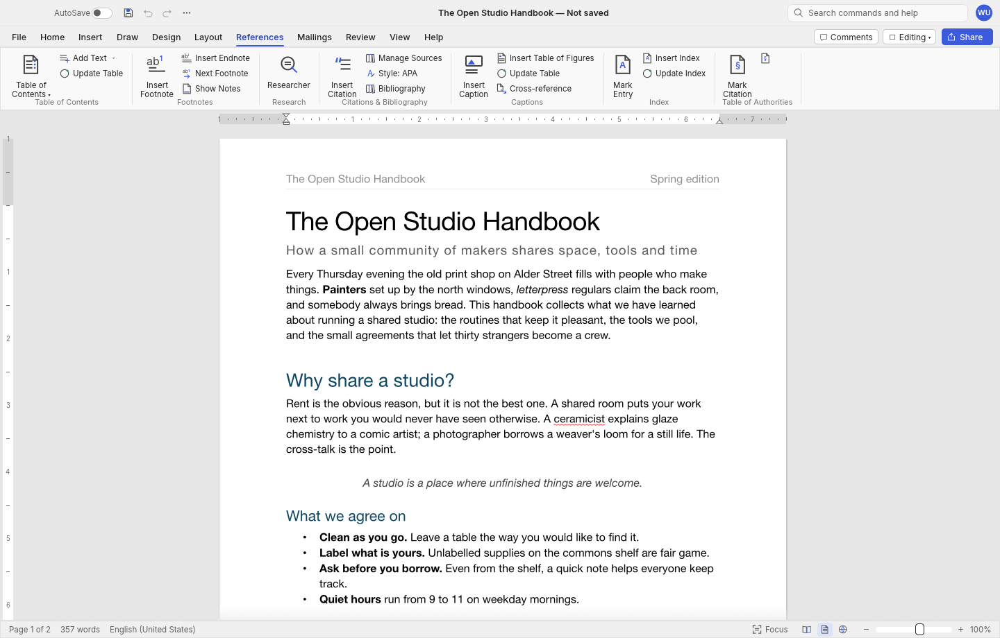
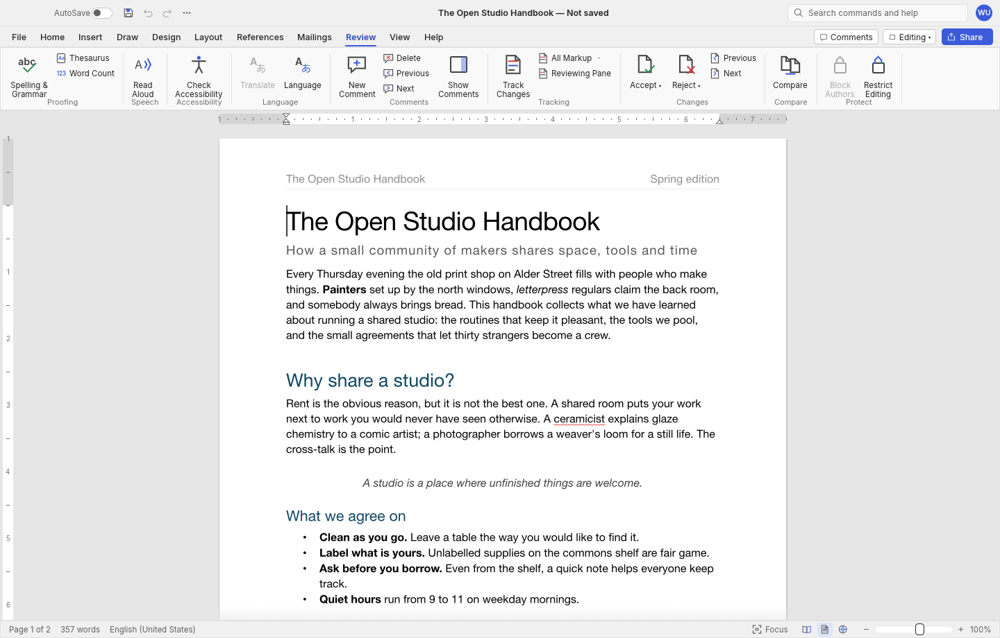
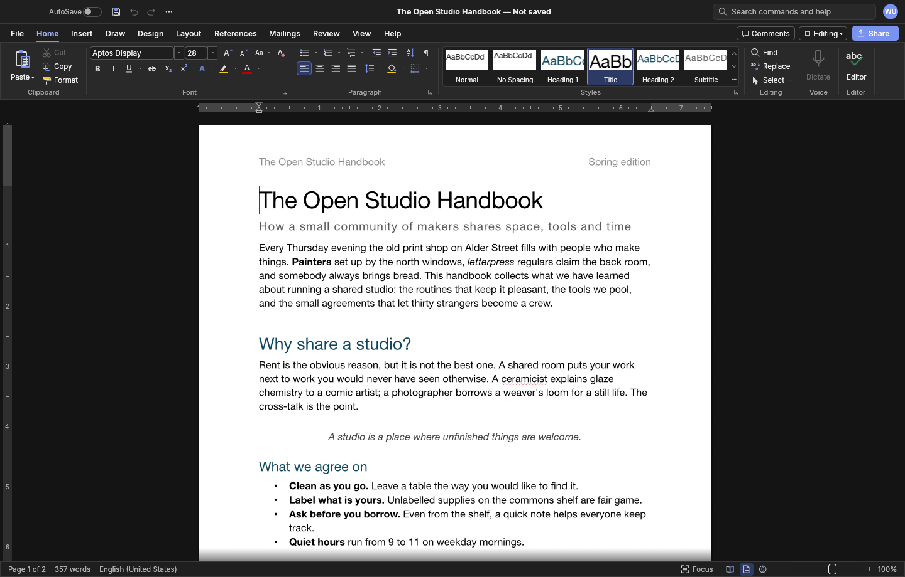
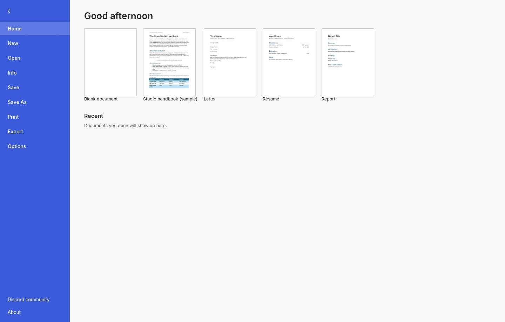

<p align="center">
  
</p>

<h1 align="center">WordForge — Microsoft Word for Mac</h1>

<p align="center">
  <b>The high-fidelity Microsoft Word (MS Word) alternative for macOS, built in pure Rust.</b>
</p>

<p align="center">
  A fast, free, open-source desktop word processor engineered specifically for macOS with the authentic Microsoft Word for Mac experience you already know: authentic ribbon architecture, rich typography, live Styles gallery, tables, margin review comments, track changes, references, and mail merge. Reads and writes Microsoft Word (.docx) documents natively with pure Rust GPU acceleration on Apple Silicon and Intel Macs.
</p>

<p align="center">
  
  
  
  
  
</p>

<p align="center">
  <a href="#why-wordforge-for-mac"><b>Why WordForge for Mac</b></a> ·
  <a href="#feature-comparison">Feature Comparison</a> ·
  <a href="#a-tour">A Tour</a> ·
  <a href="#what-works-today">Features & Capabilities</a> ·
  <a href="#downloads-for-macos"><b>Download for Mac</b></a> ·
  <a href="#faq">FAQ</a> ·
  <a href="https://github.com/tonmoy-y/WordForge/releases">Releases</a>
</p>

<br>

<p align="center">
  
  <br><sub><b>WordForge on macOS:</b> Native Word for Mac ribbon tabs, live Styles gallery, document rulers, and high-performance GPU layout.</sub>
</p>

---

## The Open-Source Microsoft Word Alternative for macOS

Looking for **Microsoft Word for Mac** or a free, privacy-first **MS Word for Mac alternative**? 

WordForge delivers the complete **Microsoft Word (MS Word)** document creation and editing workflow directly to macOS without requiring a Microsoft 365 subscription, Microsoft Office account, or continuous cloud synchronization. Built from the ground up in pure Rust, WordForge combines the familiar interface of **Microsoft Word for Mac** with blazing-fast native GPU rendering.

Whether you need to edit complex corporate `.docx` files, write academic research papers with footnotes and bibliographies, or draft novels and reports, WordForge gives you the authentic **Microsoft Word** experience on your Mac.

---

## Why WordForge for Mac

- **Authentic Microsoft Word for Mac Workflow:** Features the genuine Word ribbon tabs (Home, Insert, Layout, Design, References, Mailings, Review, View), identical keyboard shortcuts (`⌘+B`, `⌘+I`, `⌘+U`, `F4` repeat, `F7` spell check), and intuitive document behaviours.
- **Native Microsoft Word (.docx) Support:** Opens and saves native Microsoft Word `.docx` (OOXML) documents with full fidelity, preserving fonts, paragraph spacing, tables, headers, footers, and styles. Also exports to searchable PDF, `.odt`, `.rtf`, `.html`, `.md`, and `.txt`.
- **Engineered for macOS & Apple Silicon:** Universal macOS binary optimized for Apple Silicon (M1, M2, M3, M4) and Intel Macs. Runs as a native desktop application with full macOS Dark Mode support, Retina typography, and smooth scrolling.
- **Blazing Fast GPU Acceleration:** Pure Rust architecture using GPU acceleration. Paragraph layout is cached, so typing in large documents updates in under 2 ms. No Electron, no web runtime, and zero bloat.
- **100% Free & Subscription-Free:** No monthly fees, no Microsoft 365 license requirements, and no cloud account lock-in. A truly free and open-source alternative to Microsoft Word and Microsoft Office for Mac users.
- **Completely Private & Offline:** All spell-checking, grammar analysis, document rendering, and file processing happen 100% locally on your Mac. No telemetry and no remote servers.
- **Automation & CLI:** Includes a command-line tool (`wordforge-cli`), headless document conversion, JSON control channel, and an MCP server for document automation.

---

## Feature Comparison: WordForge vs Microsoft Word for Mac vs Alternatives

| Feature | WordForge for Mac | Microsoft Word for Mac (MS Word) | Apple Pages | LibreOffice Writer |
|---|---|---|---|---|
| **Platform Optimization** | **Native macOS Universal** (Apple Silicon + Intel) | macOS & Windows | macOS only | Cross-platform |
| **Authentic Word Ribbon** | **Yes** (Home, Insert, Layout, Design, Review, View) | Yes | No (Inspector sidebar) | No (Traditional toolbars) |
| **Native .docx Compatibility** | **Yes** (Native read/write OOXML) | Yes (Proprietary format) | Partial (Requires import/export) | Moderate (.docx filter) |
| **Subscription / Cost** | **100% Free & Open Source** | $69.99–$99.99/year (Microsoft 365) | Free with Mac | Free |
| **Engine Architecture** | **Pure Rust + GPU Acceleration** | Heavy C++ / Office Framework | Cocoa / Swift | Java / C++ stack |
| **Startup Speed** | **Sub-second instant launch** | 3 – 8 seconds | 1 – 2 seconds | 4 – 10 seconds |
| **Offline Privacy** | **100% Offline (Zero telemetry)** | Microsoft Cloud Sync / Telemetry | iCloud Sync | Offline |
| **License** | **MIT / Apache-2.0** | Proprietary Commercial | Proprietary Commercial | MPL-2.0 |

---

## A Tour of WordForge on macOS

Every screenshot below captures WordForge running natively on macOS with genuine GPU rendering:

<table>
<tr>
<td width="50%" valign="top"><p align="center"><sub><b>Insert.</b> Tables, illustrations, hyperlinks, headers & footers, page numbering, and symbols.</sub></p></td>
<td width="50%" valign="top"><p align="center"><sub><b>Layout.</b> Margins, page orientation, paper sizes, columns, section breaks, and paragraph indentation.</sub></p></td>
</tr>
<tr>
<td width="50%" valign="top"><p align="center"><sub><b>Design.</b> Document formatting, style sets, color palettes, font pairings, and paragraph spacing.</sub></p></td>
<td width="50%" valign="top"><p align="center"><sub><b>References.</b> Automated Table of Contents, footnotes & endnotes, citations, bibliography, and captions.</sub></p></td>
</tr>
<tr>
<td width="50%" valign="top"><p align="center"><sub><b>Review.</b> Offline spelling & grammar proofing, live word count, margin review comments, and track changes.</sub></p></td>
<td width="50%" valign="top"><p align="center"><sub><b>macOS Dark Mode.</b> Full high-contrast dark theme with authentic document canvas contrast.</sub></p></td>
</tr>
<tr>
<td colspan="2"><p align="center"><sub><b>File (Backstage).</b> Document templates, recent documents list, PDF export, and preferences.</sub></p></td>
</tr>
</table>

---

## What Works Today

| Category | Capabilities & Highlights |
|---|---|
| **Writing & Editing** | Fast typing with IME, smart quotes, AutoCorrect, list auto-formatting (`* `, `1. `), dashes; word, sentence, paragraph selection; drag-and-drop text; formatted clipboard; undo/redo; Find & Replace with regex |
| **Font & Character Formatting** | Font family selection, font sizes, bold, italic, underline, strikethrough, subscript, superscript, uppercase/lowercase case switching, text highlight color, font color, character spacing, Format Painter, Clear Formatting |
| **Paragraph Formatting** | Left, center, right, and justified alignment; interactive visual ruler margins and indents; before/after paragraph spacing; line spacing (1.0, 1.15, 1.5, 2.0); custom tab stops with dot/dash leaders; paragraph borders and shading; widow/orphan control |
| **Styles Gallery** | Authentic Microsoft Word styles gallery with live formatting previews; Normal, Heading 1–6, Title, Subtitle, Quote; create, modify, and update styles; style sets and themes |
| **Lists** | Bulleted lists, numbered lists, multilevel hierarchical lists, list restart numbering, custom bullet symbols |
| **Tables** | Interactive grid insertion, cell merging and splitting, table styles with banded rows, customizable borders and shading, repeating header rows across page breaks, formulas, text-to-table conversion |
| **Page Setup** | Standard and custom margins, portrait/landscape orientation, Letter/A4/Legal paper sizes, multi-column layouts, page and section breaks, first-page and odd/even headers and footers, page numbering, watermarks, page borders, automatic hyphenation |
| **Illustrations & Objects** | Image insertion, resizing, cropping, recoloring, brightness/contrast adjustments, picture styles, rotation; shapes and text boxes; floating layout with text wrapping (in line, square, top/bottom, behind, in front) |
| **References & Citations** | Automated Table of Contents generation, footnotes and endnotes, citations and bibliographies (APA, MLA, Chicago, IEEE), captions, table of figures, cross-references |
| **Review & Proofing** | Built-in offline spell check and grammar suggestions, thesaurus, live document word count, margin comment balloons, track changes with accept/reject, document comparison |
| **Mailings** | Mail merge from CSV data sources, merge fields, address blocks, greeting lines, document preview, and individual document generation |
| **View Modes** | Print Layout, Web Layout, Draft, Focus mode, Read mode, zoom slider, single/multiple page view, navigation pane, interactive rulers, gridlines, macOS Dark Mode; multilingual UI (English, 简体中文, 繁體中文, 日本語) |
| **File Formats** | Native read and write for Microsoft Word `.docx` (OOXML); PDF export with selectable text and bookmarks; import/export for `.odt`, `.rtf`, `.html`, `.md`, and `.txt` |

---

## Downloads for macOS

Download the latest version of WordForge directly for your Mac from [GitHub Releases](https://github.com/tonmoy-y/WordForge/releases/latest).

### macOS Universal Builds (Apple Silicon & Intel)

| Package | Format | Architecture | Download Link |
|---|---|---|---|
| **WordForge DMG (Recommended)** | `.dmg` | Universal (Apple Silicon M1/M2/M3/M4 + Intel) | [**Download WordForge 2.0.0 DMG**](https://github.com/tonmoy-y/WordForge/releases/download/v2.0.0/WordForge-2.0.0-macos-universal.dmg) |
| **WordForge Application Archive** | `.zip` | Universal (Apple Silicon M1/M2/M3/M4 + Intel) | [**Download WordForge 2.0.0 ZIP**](https://github.com/tonmoy-y/WordForge/releases/download/v2.0.0/WordForge-2.0.0-macos-universal.zip) |

#### Installation Instructions on macOS
1. Download the `WordForge-2.0.0-macos-universal.dmg` file.
2. Double-click to open the DMG, then drag the **WordForge** icon into your **Applications** folder.
3. Open WordForge from Launchpad, Spotlight (`⌘ + Space`), or your Applications folder.
4. *(If macOS Gatekeeper asks on first launch)*: Click **Open** or visit **System Settings → Privacy & Security** and click **Open Anyway**.

#### Checksums (v2.0.0)
```text
e267fff346df8eeae8f573b9406f195eb7662eac7de507352207d1f3b688b25b  WordForge-2.0.0-macos-universal.dmg
5195489c5afe1f96ab4653cdfddd415fdd47992f1245108a56f3beab8030ee6a  WordForge-2.0.0-macos-universal.zip
```

---

## Quick Start (Build from Source on macOS)

You can build and run WordForge locally on macOS using Cargo:

```sh
# Clone the WordForge repository
git clone https://github.com/tonmoy-y/WordForge
cd WordForge

# Run the WordForge desktop app on macOS with the sample document
cargo run --release -p wordforge -- --sample

# Or open an existing Microsoft Word document
cargo run --release -p wordforge -- document.docx
```

### Command-Line Interface (CLI)

WordForge includes `wordforge-cli` for automated batch conversions and headless document inspection on macOS:

```sh
# Convert Microsoft Word .docx to PDF, ODT, HTML, Markdown, or plain text
wordforge-cli convert report.docx report.pdf

# Extract plain text from any Word document
wordforge-cli text report.docx

# Inspect the internal structure of a .docx file as JSON
wordforge-cli inspect report.docx

# Run batch formatting commands headlessly
wordforge-cli run --template sample \
  --cmd 'select.text={"text":"Executive Summary"}' --cmd format.bold --save summary.docx
```

---

## Architecture

WordForge is structured as a modular pure Rust workspace:

| Layer | Crate | Responsibilities |
|---|---|---|
| **L0** | `wordforge-geom` | High-precision typography measurements, coordinate geometry, units |
| **L1** | `wordforge-doc`, `wordforge-fonts`, `wordforge-proof` | Document model, font shaping, HarfBuzz text layout, offline spell check & grammar |
| **L2** | `wordforge-layout`, `wordforge-docx`, `wordforge-formats` | Pagination, line breaking, table layout, OOXML (.docx) parser & generator |
| **L3** | `wordforge-render`, `wordforge-pdf` | CPU/GPU rasterization (`vello_cpu`), vector PDF export (`krilla`) |
| **L4** | `wordforge-engine` | Undo/redo stack, document session, 389 Microsoft Word commands |
| **L5** | `wordforge-mcp` | Model Context Protocol (MCP) server for document automation |
| **L6** | `wordforge-ui-egui` | Native Microsoft Word for Mac ribbon interface, dialogs, rulers, and canvas |
| **Apps** | `wordforge`, `wordforge-cli` | macOS desktop application, command-line tools |

---

## Frequently Asked Questions (FAQ)

### Is WordForge a free alternative to Microsoft Word for Mac?
Yes. WordForge is 100% free and open-source under the dual MIT / Apache-2.0 license. You do not need a Microsoft 365 subscription, Microsoft Office license key, or Microsoft account to create, open, edit, and save documents.

### Can WordForge open and save Microsoft Word (.docx) documents?
Yes. WordForge has native read and write support for the standard Microsoft Word OOXML (`.docx`) file format. Documents created in Microsoft Word for Mac or Windows open directly in WordForge, and documents saved by WordForge open seamlessly in Microsoft Word.

### Does WordForge work on Apple Silicon (M1, M2, M3, M4) Macs?
Yes. WordForge is distributed as a Universal macOS Binary containing native machine code for both Apple Silicon (ARM64) and Intel (x86_64) architectures. It runs at full native performance with zero emulation.

### How does WordForge differ from Apple Pages?
Apple Pages uses a proprietary format that requires manual export to `.docx` and features an inspector-sidebar layout rather than the standard Microsoft Word ribbon. WordForge provides the authentic Microsoft Word ribbon workflow and works natively with `.docx` files as its primary format.

### Does WordForge send my document data to any cloud service?
No. WordForge operates 100% offline. Spell checking, document layout, formatting, and file saves occur strictly on your local Mac disk. No document content, telemetry, or user data is ever transmitted over the network.

---

## License & Legal Notices

WordForge is dual-licensed under [MIT](LICENSE-MIT) or [Apache-2.0](LICENSE-APACHE), at your option. Copyright (c) 2026 WordForge contributors. Required notices are located in [NOTICE](NOTICE).

Bundled fonts, icons, and assets maintain their respective open-source licenses, detailed in [ATTRIBUTION.md](ATTRIBUTION.md).

<sub>Microsoft, Microsoft Word, Microsoft Office, and MS Word are trademarks or registered trademarks of Microsoft Corporation in the United States and/or other countries. Apple, macOS, and Mac are trademarks of Apple Inc. WordForge is an independent open-source project and is not affiliated with, sponsored by, or endorsed by Microsoft Corporation or Apple Inc. These names are referenced solely for descriptive compatibility and workflow fidelity purposes.</sub>
